---

## 👩‍💻 Sobre mí

**Ingeniera de Sistemas e Ingeniera Mecatrónica** (Universidad EAN, Bogotá) con experiencia multidisciplinaria en desarrollo de software, automatización, fabricación digital, diseño e integración de soluciones tecnológicas.

Mi perfil combina programación, electrónica, diseño CAD/CAM, manufactura digital, infraestructura tecnológica y prototipado: analizo necesidades, selecciono y adapto tecnologías, e integro herramientas digitales con procesos físicos para desarrollar soluciones funcionales. Promuevo la innovación, el conocimiento abierto y la educación STEM.

- 🧩 **ROBOTSchool** · Líder de Desarrollo de Software y Coordinadora de Producción: plataforma interna de inventarios y producción (PHP, MySQL, Docker, CI/CD) con más de 40 migraciones, trazabilidad de ensambles, colas de impresión 3D y seguimiento logístico para 69 colegios.
- 🛠️ **FabLab Universidad EAN** · Prototipado, fabricación digital e integración tecnológica: impresión 3D FDM/SLA, corte y grabado láser CO₂, marcado de fibra, impresión UV y CNC.
- 🌱 **STEMChocó** · Líder de Formación STEM: ruta formativa en robótica y nanosatélite CanSat para niñas de comunidades vulnerables.
- 🖥️ **adnr.engineer** · Servidor Linux autohospedado donde despliego mi portafolio y construyo un repositorio de conocimiento tecnológico.

## 🧰 Stack

| 💻 Software | 🏭 Fabricación digital | 🤖 Automatización |
| :-- | :-- | :-- |
| PHP, Python, C/C++, Java | Impresión 3D FDM/SLA | Visión artificial (OpenCV, YOLO) |
| MySQL, APIs REST, Bootstrap | Corte y grabado láser CO₂, marcado de fibra | ESP32, comunicación serial |
| Docker, CI/CD, Git Flow, Linux | CNC Router, impresión UV | NFC / QR, ROS |

## 🚀 Proyectos destacados

| Proyecto | Qué hace | Tecnologías |
| :-- | :-- | :-- |
| [**ESPCAR32**](https://github.com/IngDinoAlip/ESPCAR32) | Carro robótico autónomo con monitoreo ambiental (CO₂, temperatura, humedad), dashboard web en tiempo real y Firebase | `C++` `ESP32` `Firebase` `JavaScript` |
| [**Brazo robótico con visión (YOLO + ESP32)**](https://github.com/IngDinoAlip/Deteccion-y-clasificacion-robotica-YOLO-ESP32) | Detecta y clasifica piezas en tiempo real y las envía por serial a un brazo robótico | `OpenCV` `YOLO` `Python` `ESP32` |
| [**Control industrial con visión artificial**](https://github.com/IngDinoAlip/Control-industrial-con-vision-artificial-OpenCV) | Supervisa una selladora de cajas y controla solenoides con interfaz gráfica | `Python` `OpenCV` `Arduino Nano` |
| [**Triage automático con IA**](https://github.com/IngDinoAlip/Triage-Automatico---IA) | Compara y entrena modelos para clasificar triage (KTAS) | `Python` `scikit-learn` `ML` |
| [**NFC Profiles**](https://github.com/IngDinoAlip/NFCPROFILES) | Perfiles digitales enlazados a etiquetas NFC | `HTML` `NFC` |

## 📊 Actividad

---

🔧 Hecho en Bogotá, Colombia · de lo digital a lo físico · <a href="https://adnr.engineer">adnr.engineer</a>

